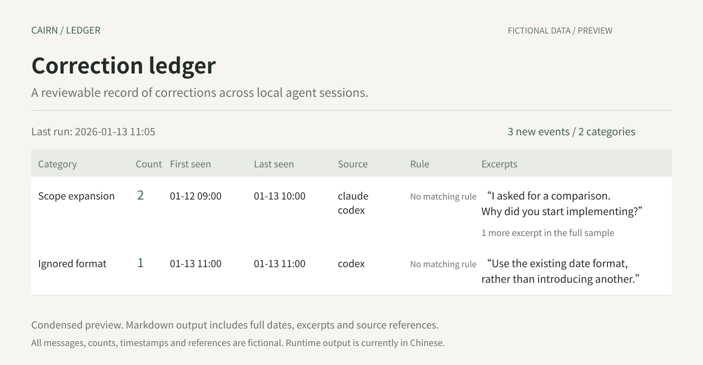

# Cairn Ledger

**English** · [简体中文](README.zh-CN.md)

**A local correction ledger for AI agent sessions.**

Cairn Ledger identifies user corrections to agent behavior in local Claude Code and Codex transcripts. It groups corrections by category, counts recurring issues, and preserves short excerpts with source references for review.



*Illustrative preview using fictional data. Runtime output is currently in Chinese; [view the complete sample](docs/example-output.md).*

[Offline demo](#offline-demo) · [Getting started](#getting-started) · [Setup and operations](docs/setup.md) · [How it works](docs/how-it-works.md)

## What gets recorded

| Signal in a conversation | Treatment |
| --- | --- |
| The user corrects an agent's approach, such as expanding scope or ignoring an agreement | Considered for classification; recorded after local validation |
| Routine content edits, such as shortening a title | Not recorded |
| Additional facts, new tasks, or initial constraints | Not recorded |
| Insufficient context to establish a correction | Not recorded |

Each original user message counts at most once. Repeated scans do not duplicate events. The ledger provides records and source references; **it does not modify your rules automatically**.

## Offline demo

Requires macOS and Python 3.9+. The demo uses fictional data and needs no Codex login. It does not read transcripts or call a model.

```sh
git clone https://github.com/alexliu072903-bit/cairn-ledger.git
cd cairn-ledger
python3 docs/demo.py
```

The command prints the path to a temporary `regressions.md`. Open it in a Markdown editor to review categories, counts, first and latest occurrence times, sources, rule references, and excerpts. All source references in the demo are fictional. Demo and runtime output are currently in Chinese.

## Getting started

Processing real transcripts also requires an authenticated Codex CLI and local Claude Code or Codex transcripts. This is an early version: transcript formats and session deep links have compatibility limits. See [coverage and limitations](docs/how-it-works.md#覆盖范围).

### 1. Install outside the source repository

```sh
python3 install.py
```

Code is copied to `~/.codex/ledger/`. Existing configuration and data are preserved, and previous code is backed up. Installation does not start a service; classification is disabled by default.

### 2. Prepare directories and configure the installation

```sh
mkdir -p ~/Documents/correction-ledger ~/Documents/agent-rules
touch ~/Documents/agent-rules/{self,process,build,engineering,foundations}.md
open -e ~/.codex/ledger/config.json
```

Set `sources`, `vault`, `self_root`, `codex`, and `since` for your environment. Remove sources you do not use. Rule files may be empty. Set `since`, the initial backfill timestamp, to a recent date you intend to review. See the [configuration reference](docs/setup.md#配置).

### 3. Check sources and review the model data flow

```sh
python3 ~/.codex/ledger/ledger.py scan
```

Scan output includes local file paths and should remain private. When classification is enabled, candidate excerpts, necessary preceding context, rule text, and existing category definitions are sent through your authenticated Codex CLI to the model service. Common secrets, email addresses, and phone numbers are subject to pattern-based redaction. **Rule text is sent as written, and redaction does not guarantee removal of all personal information.**

If you accept this data flow, set `"classification_enabled": true` in the configuration.

### 4. Run and review the output

```sh
python3 ~/.codex/ledger/process-ledger
open ~/Documents/correction-ledger/regressions.md
```

By default, only completed turns in files unchanged for at least 10 minutes are eligible. Zero new events may mean no eligible corrections or pending turns. Review the source status at the top of the output alongside the count. Output timestamps currently use Asia/Shanghai.

After confirming a successful manual run, follow the [background service instructions](docs/setup.md#后台运行) to enable watching.

## Data storage

| Location | Contents |
| --- | --- |
| This repository | Code, documentation, fictional examples, and tests |
| `~/.codex/ledger/` | Local configuration, cursors, logs, and code backups |
| Your configured `vault` | The `ledger.jsonl` event ledger and `regressions.md` reading view |

Runtime data remains on your machine and should not be committed to the repository. Enabling classification sends model requests as described above. See [the processing and data boundaries](docs/how-it-works.md) for details.

## Development

```sh
python3 -m unittest discover -s tests -v
```

Tests use fictional data, do not read real transcripts, and do not call a model. See [repository structure and updates](docs/development.md).

The README and preview are available in English and Chinese. Detailed operational documentation and generated ledger output are currently in Chinese.
