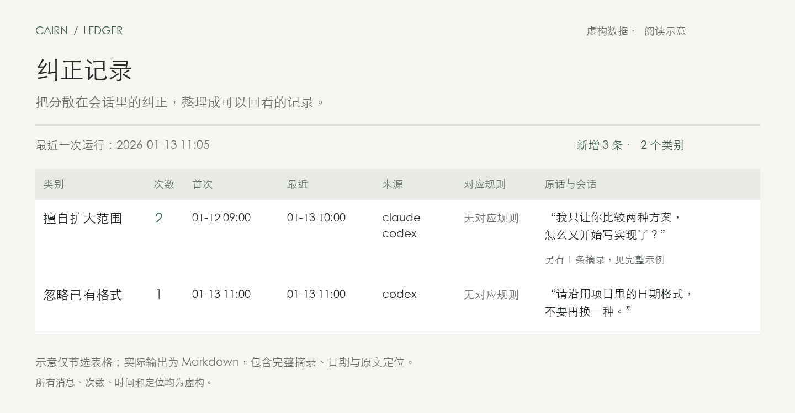

# Cairn Ledger

**让你对 Agent 的纠正，留下一本可以回看的账。**

从本机 Claude Code 与 Codex 会话中识别「做法被纠正」的时刻，按类别汇总次数，并保留短摘录与原文定位。你可以看到哪些问题反复发生，再决定要不要调整规则。



*示意预览，全部为虚构数据。实际产出为 Markdown 表格；[查看完整示例](docs/example-output.md)。*

[试用演示](#先看产出) · [开始使用](#开始使用) · [配置与后台运行](docs/setup.md) · [机制与边界](docs/how-it-works.md)

## 它会记下什么

| 会话中的信号 | 处理方式 |
| --- | --- |
| 用户指出 Agent 擅自扩大范围、忽略约定或做错了方法 | 作为纠正候选，分类并校验后入账 |
| 「标题改短一点」这样的普通内容编辑 | 不入账 |
| 补充事实、新任务、初始约束 | 不入账 |
| 缺少上下文，无法确认是否为纠正 | 不入账 |

同一条原始消息最多计 1 次。重新扫描不会重复计数。它提供记录和定位，**不会自动修改你的规则**。

## 先看产出

macOS、Python 3.9+。演示只生成虚构数据，不需要 Codex 登录，不读取会话，不调用模型。

```sh
git clone https://github.com/alexliu072903-bit/cairn-ledger.git
cd cairn-ledger
python3 docs/demo.py
```

命令会输出 `regressions.md` 的临时路径。用 Markdown 编辑器打开，就能看到类别、次数、首次与最近时间、来源、对应规则和摘录。演示中的定位同样为虚构内容。

## 开始使用

真实会话分类还需要：已登录的 Codex CLI，以及本机 Claude Code 或 Codex transcript。当前为早期版本，日志格式和深链兼容性仍有限制，详见[覆盖范围](docs/how-it-works.md#覆盖范围)。

**1. 安装到仓库外。**

```sh
python3 install.py
```

代码复制到 `~/.codex/ledger/`。已有配置与数据保留，旧代码先备份；安装不会启动服务，分类默认关闭。

**2. 准备输出与规则目录，编辑配置。**

```sh
mkdir -p ~/Documents/correction-ledger ~/Documents/agent-rules
touch ~/Documents/agent-rules/{self,process,build,engineering,foundations}.md
open -e ~/.codex/ledger/config.json
```

按实际情况修改 `sources`、`vault`、`self_root`、`codex` 和 `since`。不用的来源应从配置移除；规则文件可以为空。`since` 是首次回溯起点，请先设为你想检查的近期日期。[逐项配置说明 →](docs/setup.md#配置)

**3. 检查来源，确认模型数据流。**

```sh
python3 ~/.codex/ledger/ledger.py scan
```

扫描结果包含本机文件路径，只在本地查看。启用分类后，候选短片段、必要前文、规则文本及已有类别会经当前登录的 Codex CLI 发给模型服务。常见密钥、邮箱和手机号会尝试脱敏，**规则文本会原样发送，脱敏不保证覆盖所有个人信息**。

接受这一数据流后，在配置中设 `"classification_enabled": true`。

**4. 运行并查看。**

```sh
python3 ~/.codex/ledger/process-ledger
open ~/Documents/correction-ledger/regressions.md
```

默认只处理已结束、文件静默 ≥ 10 分钟的轮次。`新增 0` 可能是没有符合条件的纠正，也可能仍有未结束轮次；请一起看视图顶部的来源状态。

确认手动运行正常后，再按[后台运行说明](docs/setup.md#后台运行)开启监听。

## 数据放在哪里

| 位置 | 内容 |
| --- | --- |
| 这个仓库 | 代码、文档、虚构示例与测试 |
| `~/.codex/ledger/` | 本机配置、游标、日志和代码备份 |
| 你配置的 `vault` | `ledger.jsonl` 事实账本与 `regressions.md` 阅读视图 |

运行数据保留在本地，不提交到仓库。启用后的模型请求按上面的数据流发送；[完整处理过程 →](docs/how-it-works.md)

## 开发与维护

```sh
python3 -m unittest discover -s tests -v
```

测试使用虚构数据，不读取真实会话、不调用模型。[目录说明与更新方式 →](docs/development.md)
